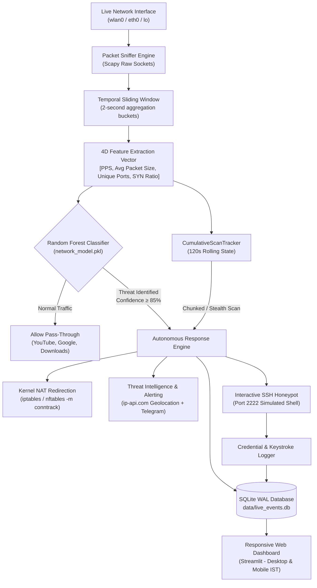

# Autonomous Network Shield
### AI-Powered Intrusion Prevention, Deception & Telemetry System

[](https://www.python.org/)
[](https://scikit-learn.org/)
[](https://netfilter.org/)
[](https://streamlit.io/)
[-blueviolet.svg)](https://sqlite.org/)
[](tests/test_shield.py)

---

## 1. Why We Built This Project (Problem Statement)

### The Limitations of Traditional Security Systems
1. **The Blind Drop Problem (Unknown Attacker Intentions)**:
   Traditional Firewalls and Intrusion Prevention Systems (IPS) such as standard `iptables` or Snort react to suspicious traffic by simply dropping or rejecting packets (`DROP` / `REJECT`).
   - **What happens**: The attacker immediately knows they hit a perimeter barrier and shifts to a new IP or evasive technique.
   - **The critical flaw**: Security administrators learn **nothing** about the attacker's true intentions, tools, payloads, or target credentials.
2. **False Positives on High-Throughput Benign Traffic**:
   Traditional volumetric anomaly detectors trigger alerts whenever packet rates spike. Modern internet usage—such as streaming 4K YouTube videos, downloading ISOs, or video conferencing—generates thousands of packets per second. Naive detectors misclassify this benign traffic as a Denial-of-Service (DoS) attack, disrupting normal user browsing.
3. **Evasion via Chunked / Low-and-Slow Scans**:
   Attackers often evade single-window detection thresholds by probing ports in small batches (e.g., 15–20 ports at a time with pauses in between) to stay under rate-limiting alarms.

### Our Solution: Autonomous Defense Through Deception
The **Autonomous Network Shield** reimagines perimeter defense by combining Machine Learning with **Cyber Deception**:
- Instead of dropping packets, malicious actors are autonomously **redirected at the Linux kernel level (`iptables` / `nftables` NAT PREROUTING) into an interactive SSH Honeypot**.
- While the attacker believes they have breached a vulnerable Linux server, our system traps them, records their **usernames, passwords, and shell keystrokes in real time**, and pushes instant **Telegram push notifications** and live **Streamlit dashboard telemetry** in Indian Standard Time (IST).
- Legitimate traffic (YouTube, Google, browsing) is mathematically differentiated using connection tracking (`conntrack`) and Layer-4 TCP flag ratio analysis (`syn_ratio`), ensuring **zero false positives**.

---

## 2. System Architecture



---

## 3. Custom Dataset Generation & Feature Engineering

### Capturing Real-World Baselines (`tcpdump` & Scapy)
To ensure the machine learning model accurately mirrors actual network conditions rather than artificial toy data, the training distribution was engineered from real network packet captures using `tcpdump` and Scapy:
1. **Benign Traffic Baseline**: Captured real web sessions including YouTube 1080p/4K streaming, Google searches, multi-threaded file downloads, and DNS lookups across physical interfaces.
2. **Attack Traffic Profiles**: Generated controlled horizontal port scans (sequential and randomized) and volumetric TCP SYN floods using raw socket simulation tools.

### The 4 Feature Dimensions:
Each 2-second time window per source IP is reduced into a 4-dimensional statistical feature vector:

| Feature Dimension | Unit | Benign Traffic (YouTube / Web) | Port Scan (Horizontal Sweep) | SYN Flood (Volumetric DoS) |
| :--- | :--- | :--- | :--- | :--- |
| **`packets_per_sec` (PPS)** | float | $15 - 2500$ (High during video) | $15 - 1500$ (Moderate to High) | **$200 - 8000+$ (Extreme)** |
| **`avg_packet_size`** | bytes | **$400 - 1500\text{ B}$ (Payloads)** | $40 - 90\text{ B}$ (Bare SYN) | $40 - 80\text{ B}$ (Bare SYN) |
| **`unique_ports`** | integer | $1 - 4$ (Ports 80, 443, 53) | **$20 - 1024+$ (Wide Sweep)** | $1 - 4$ (Target Service) |
| **`syn_ratio`** | ratio ($0-1$) | **$\le 0.05$ (Mostly Data/ACKs)** | **$\ge 0.85$ (SYN Probes)** | **$\ge 0.95$ (Pure SYN)** |

### How `syn_ratio` Solved the YouTube / Google False Positive
Video streaming sends hundreds of packets per second, causing naive volumetric models to trigger false flood alerts. By inspecting Layer-4 TCP flags (`flags & 0x02 and not flags & 0x10`):
- YouTube video buffers consist entirely of `ACK` and `PSH-ACK` payload packets (`syn_ratio = 0.0`).
- Floods and port scans consist almost exclusively of `SYN` handshakes (`syn_ratio ≈ 1.0`).
- This mathematical separation guarantees that streaming video is never falsely blocked.

---

## 4. Machine Learning Model & Decision Engine

- **Model Type**: Random Forest Classifier (`RandomForestClassifier`, 100 estimators).
- **Why Random Forest**:
  - Non-linear decision boundaries handle complex combinations (e.g. high PPS is benign if packet size is large, but malicious if packet size is small and SYN ratio is 1).
  - Fast inference: evaluates feature vectors in under **$0.2\text{ ms}$**, easily sustaining wire-speed packet aggregation.
- **Adaptive Confidence Thresholding**:
  - Requires a minimum confidence floor of **$85\%$**.
  - Enforces a top-1 vs top-2 probability margin of $\ge 0.10$ to reject ambiguous edge-case traffic.
- **Incremental / Chunked Scan Defense (`CumulativeScanTracker`)**:
  - Maintains a sliding 120-second rolling history per source IP.
  - If an attacker scans in small bursts (e.g., 20 ports, pause, 20 ports), single-window classifiers might hesitate. The tracker aggregates state across windows and triggers when:
    $$\text{UniquePorts} \ge 20 \quad\land\quad \text{SynRatio} \ge 0.75 \quad\land\quad \text{AvgPacketSize} \le 120\text{ B}$$
  - Enforces automatic LRU memory eviction at 10,000 tracked IPs to prevent state-exhaustion DoS attacks.

---

## 5. Core Project Components

| Module | Location | Description |
| :--- | :--- | :--- |
| **Packet Sniffer** | [`src/sniffer.py`](src/sniffer.py) | Captures live packets via raw `AF_PACKET` sockets; aggregates traffic into 2s temporal buckets; extracts 4D feature vectors. |
| **Pipeline Daemon** | [`src/pipeline.py`](src/pipeline.py) | Central orchestration engine; runs model inference, cumulative tracking, alert cooldowns, and graceful signal cleanup. |
| **Firewall Controller** | [`src/firewall.py`](src/firewall.py) | Injects dynamic kernel NAT PREROUTING redirect rules with `conntrack --ctstate NEW` support. |
| **SSH Honeypot** | [`src/honeypot.py`](src/honeypot.py) | Emulates an OpenSSH Ubuntu daemon on port 2222; logs captured credentials and shell keystrokes. |
| **Alerts & Geolocation** | [`src/alerts.py`](src/alerts.py) | Resolves attacker geo-coordinates (ip-api.com with RFC 1918 caching) and dispatches instant Telegram push alerts. |
| **Timezone Utility** | [`src/utils.py`](src/utils.py) | Converts UTC timestamps to Indian Standard Time (IST, UTC+5:30) with resilient multi-format parsing. |
| **Web Dashboard** | [`dashboard/app.py`](dashboard/app.py) | Mobile-responsive Streamlit dashboard displaying live KPI metrics, incident tables, and keystrokes. |

---

## 6. Installation & Setup

### Prerequisites
- Linux OS (Fedora, Arch Linux, Ubuntu/Debian, CentOS)
- Python 3.11+
- Root privileges (`sudo`) for raw socket binding and firewall rule injection
- `iptables` or `nftables`

### 1. Clone & Install Dependencies
```bash
git clone https://github.com/Aayush-2805/Autonomous-Network-Shield.git
cd Autonomous-Network-Shield

# Create and activate virtual environment
python3 -m venv cnvenv
source cnvenv/bin/activate

# Install required Python packages
pip install -r requirements.txt
```

### 2. Configure Environment Variables
Copy `.env.example` to `.env` and provide your optional Telegram bot credentials:
```bash
cp .env.example .env
nano .env
```
Add your credentials:
```bash
TELEGRAM_BOT_TOKEN="your_bot_token_from_botfather"
TELEGRAM_CHAT_ID="your_numerical_chat_id"
```

### 3. Train the Classifier
Train the Random Forest model and generate `data/network_model.pkl`:
```bash
./cnvenv/bin/python models/train_classifier.py
```

---

## 7. Running the System

Run components in separate terminal windows:

### Terminal 1: Start the Protection Pipeline (Requires Sudo)
```bash
cd /path/to/Autonomous-Network-Shield
source cnvenv/bin/activate
sudo ./cnvenv/bin/python src/pipeline.py
```
*The pipeline auto-detects active interfaces (`wlan0`, `eth0`, `lo`), spawns the Honeypot daemon on port 2222, and starts real-time packet classification.*

### Terminal 2: Launch the Web Dashboard
```bash
cd /path/to/Autonomous-Network-Shield
source cnvenv/bin/activate
streamlit run dashboard/app.py
```
- **Local Access**: Open `http://localhost:8501`.
- **Mobile Access on Wi-Fi**:
  1. Allow port 8501 through Linux firewalld (one-time command):
     ```bash
     sudo firewall-cmd --zone=public --add-port=8501/tcp --permanent && sudo firewall-cmd --reload
     ```
  2. Open `http://<laptop_ip>:8501` on your mobile phone connected to the same Wi-Fi.
- **Mobile Access from Anywhere (4G / 5G Mobile Data)**:
  Run a secure reverse-tunnel:
  ```bash
  npx localtunnel --port 8501
  ```

---

## 8. Simulating Attacks

Use [`tests/simulate_attacks.py`](tests/simulate_attacks.py) to test the shield against various attack vectors:

### 1. Fast Horizontal Port Scan (500 Ports)
```bash
sudo ./cnvenv/bin/python tests/simulate_attacks.py --target <YOUR_IP> --mode scan --count 500
```
- **Result**: Shield detects horizontal scan ($100\%$ confidence), injects firewall redirect, traps IP into honeypot, sends Telegram alert, and logs incident in IST.

### 2. Chunked / Low-and-Slow Port Scan (20 ports, pause, 20 ports)
```bash
sudo ./cnvenv/bin/python tests/simulate_attacks.py --target <YOUR_IP> --mode scan --count 40 --chunk-size 20 --chunk-delay 2
```
- **Result**: `CumulativeScanTracker` aggregates unique destination ports across the 120s sliding window and promotes the attacker to `port_scan` upon crossing threshold.

### 3. Volumetric TCP SYN Flood (1500 Packets)
```bash
sudo ./cnvenv/bin/python tests/simulate_attacks.py --target <YOUR_IP> --mode flood --count 1500 --port 80
```
- **Result**: Volumetric flood detected immediately with 100% confidence.

### 4. Benign Web Traffic (Baseline Test)
```bash
sudo ./cnvenv/bin/python tests/simulate_attacks.py --target <YOUR_IP> --mode normal --count 100
```
- **Result**: Classified as normal (`0`); zero alerts, zero redirection.

---

## 9. Automated Verification Suite

Run the full automated test suite containing **25 unit tests** verifying sniffer mechanics, model predictions, conntrack firewall states, alert cooldowns, chunked scan tracking, and IST time formatting:

```bash
./cnvenv/bin/python -m unittest tests/test_shield.py
```
```text
Ran 25 tests in 0.963s

OK
```

---

## 10. Database Schema (`data/live_events.db`)

Stored in SQLite using **Write-Ahead Logging (WAL)** mode for concurrent multi-process access:

1. **`incidents`**:
   - `id`, `src_ip`, `attack_type`, `confidence`, `pps`, `avg_pkt_size`, `unique_ports`, `syn_ratio`, `country`, `city`, `isp`, `detected_at`
2. **`connections`**:
   - `id`, `src_ip`, `connected_at`
3. **`credentials`**:
   - `id`, `conn_id`, `username`, `password`, `captured_at`
4. **`keystrokes`**:
   - `id`, `conn_id`, `data`, `captured_at`

---

## 11. Viva Defense Quick Reference

- **Q: Why honeypot deception instead of packet dropping?**
  *A: Dropping packets notifies the attacker they are blocked, prompting evasion. Redirecting them to a honeypot wastes their resources, protects real services, and harvests their passwords, exploit tools, and intentions.*
- **Q: How does the system prevent blocking YouTube or Google?**
  *A: YouTube video streaming consists of large packets ($> 500\text{ B}$) and 0% SYN flags (`syn_ratio = 0.0`), while attacks consist of tiny packets ($< 80\text{ B}$) with near 100% SYN flags. Furthermore, `conntrack --ctstate NEW` ensures existing browser sessions are never redirected.*
- **Q: How are low-and-slow port scans handled?**
  *A: A stateful `CumulativeScanTracker` maintains a 120-second rolling window that detects cumulative unique destination ports ($\ge 20$) even when distributed across multiple small batches.*
- **Q: What happens on shutdown?**
  *A: The pipeline registers POSIX signal handlers (`SIGINT`, `SIGTERM`) that automatically flush all kernel `iptables` NAT PREROUTING redirect rules, preventing network disruptions.*
